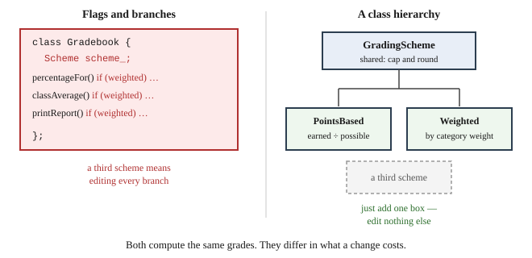

# Chapter 20 — Inheritance

## Learning Objectives

When you finish this chapter you will be able to:

- State the weighted-grading requirement precisely and compute a weighted percentage by hand. *(SLO 2.1)*
- Compare a flag-and-branch design with a class hierarchy, and name the specific costs of each. *(SLO 2.3, 2.8)*
- Identify "is-a" relationships and distinguish them from "has-a". *(SLO 2.3)*
- Declare a derived class and call a base constructor. *(SLO 2.3)*
- Use `protected` members appropriately. *(SLO 2.3)*
- Override a base class member function. *(SLO 2.3)*
- Choose between inheritance and composition. *(SLO 2.3, 2.8)*
- Build Grade Calculator v3.0 — weighted-category grading, working.

---

## 20.1 A New Requirement: Weighted Grading

Since Chapter 1, your specification has carried a sentence:

> **Out of scope for Course I:** weighted-category grading, in which categories such as exams and homework carry different percentages of the final grade. This calculator computes grades on total points only. Weighted grading is deferred as a planned future enhancement.

Twelve chapters of Course I never needed it. Chapter 13 had you analyze it. This chapter builds it.

### What weighted grading is

Assignments belong to **categories**, and each category carries a **weight** — a percentage of the final grade:

| Category | Weight |
|---|---|
| Exams | 50% |
| Homework | 30% |
| Participation | 20% |

Each category is scored **separately** as a fraction of its own possible points. Those fractions are then combined by weight.

### Worked by hand

A student with `Exam 1` at 90/100, `HW1` at 10/10, and `HW2` at 5/10:

**Points-based** adds everything together:

```text
(90 + 10 + 5) / (100 + 10 + 10) = 105 / 120 = 87.5%
```

**Weighted** scores each category first:

```text
Exams:    90/100  = 0.90  ×  50 = 45.0
Homework: 15/20   = 0.75  ×  30 = 22.5
                                  ----
                                  67.5   out of the 80 weight used
67.5 / 80 × 100 = 84.4%
```

```text
points-based: 87.5%
weighted:     84.4%
```

**Same work, two defensible grades, a 3.1 point difference.** Neither is wrong. They answer different questions, and an instructor is entitled to choose.

Note that Participation contributed nothing because the student has no participation assignments yet. The design decision above — **divide by the weight actually used, not by 100** — means a student is not penalized for work that has not been assigned. That was one of the questions Chapter 13 asked you to answer before knowing the implementation.

### Why the accumulator pattern cannot do this

Chapter 7 Section 7.9 said points-based grading *is* the accumulator pattern: two running totals, one division. It also said what that implies.

**Every point counts the same, regardless of where it came from.** Two running totals cannot express "these points are worth more than those." You would need separate totals per category, combined afterward by weight — a fundamentally different computation, not a variation on the same one.

That is why this arrives now. It is not a feature Course I forgot; it is a feature Course I's approach could not express.

---

## 20.2 Two Designs Compared

You have a working `Gradebook` with one grading rule. You need two. There are two ways to do it, and the choice matters more than it first appears.



**Figure 20.1 — Two designs for supporting more than one grading scheme.**

*Description of Figure 20.1.* The left panel shows the **flag design**: one `Gradebook` class holding a `Scheme scheme_` member, with three operations — `percentageFor`, `classAverage`, `printReport` — each containing an `if (weighted)` branch. A note records that a third scheme means editing every branch.

The right panel shows the **hierarchy design**: an abstract `GradingScheme` at the top holding shared behavior (capping and rounding), with `PointsBased` and `Weighted` below it. A dashed box shows where a third scheme would go, with a note that adding one means adding a box and editing nothing else.

Both compute the same grades. They differ in what a change costs.

### Design A — a flag and branches

```cpp
class Gradebook {
public:
    enum class Scheme { Points, Weighted };

    double percentageFor(const Student& s) const {
        if (scheme_ == Scheme::Weighted) {
            // ... weighted computation ...
        } else {
            // ... points-based computation ...
        }
    }
private:
    Scheme scheme_;
};
```

This works. It is not stupid, and in a small program it would be entirely reasonable. Its costs are specific:

**The branch spreads.** Today one function needs it. Tomorrow the class average, the report header, and the file format each need to know which scheme is active. Every new operation on grades brings a new branch.

**A third scheme touches every branch.** Adding weighted-with-drop-lowest means finding each `if` and extending it. Miss one and you have a silent logic error of exactly the kind Chapter 4 Section 4.9.3 described.

**The branches cannot be tested independently.** Testing the weighted path means constructing a `Gradebook` with the flag set correctly. There is no way to test the weighted rule on its own.

**`Gradebook` accumulates knowledge that is not its job.** A gradebook holds students and produces reports. Under this design it also knows the arithmetic of every grading scheme that will ever exist.

### Design B — a class hierarchy

Make each scheme a separate type with a shared parent:

```cpp
class GradingScheme { /* shared behavior */ };
class PointsBased : public GradingScheme { /* one rule */ };
class Weighted    : public GradingScheme { /* another rule */ };
```

`Gradebook` holds one of these and asks it for a percentage. It does not know which kind it has.

**A third scheme is a new class, and nothing existing changes.**

### The comparison

| | Flag and branches | Class hierarchy |
|---|---|---|
| Adding a third scheme | edit every branch | add one class |
| Testing one rule alone | not possible | construct it directly |
| Where scheme knowledge lives | inside `Gradebook` | inside each scheme |
| Risk of missing a branch | real | none — there are none |
| Lines for two schemes | fewer | more |
| Lines for five schemes | many more | slightly more |

**The hierarchy costs more up front.** That is honest, and it is why the flag design is right for some programs. It pays off when the number of variants grows or when the variants must be tested and reasoned about separately — which is exactly this case.

You will build Design B. Chapter 21 will show what it makes possible that Design A cannot do at all.

---

## 20.3 Modeling "Is-A" Relationships

**Inheritance** creates a new class from an existing one. The new class gets everything the original had, and may add or change behavior.

The relationship it expresses is **"is-a"**:

- A `PointsBased` **is a** `GradingScheme`.
- A `Weighted` **is a** `GradingScheme`.

Test any proposed inheritance by saying it aloud. If "is-a" sounds wrong, inheritance is wrong.

Contrast with **"has-a"**, which means **composition** — one object holding another:

- A `Gradebook` **has a** `GradeScale`.
- A `Student` **has** `Assignment`s.

A `Gradebook` is not a kind of `GradeScale`, so it holds one rather than inheriting from one. **Getting this backwards is the most common inheritance mistake**, and Section 20.10 returns to it.

---

## 20.4 Base and Derived Classes

The **base class** holds what is common:

```cpp
class GradingScheme {
public:
    explicit GradingScheme(const std::string& name) : name_(name) {}

    const std::string& name() const { return name_; }

protected:
    /** Applies the course cap-and-round policy. Shared by every scheme. */
    static double finalize(double rawPercentage);

private:
    std::string name_;
};
```

A **derived class** names its base after a colon:

```cpp
class PointsBased : public GradingScheme {
public:
    PointsBased() : GradingScheme("Points-based") {}
    double computePercentage(const std::vector<Assignment>& work) const;
};
```

`public` inheritance means "is-a" — everything public in the base stays public in the derived class. Other forms exist and are rarely what you want.

A `PointsBased` object contains a complete `GradingScheme` inside it. It has a `name_`, it can be asked its `name()`, and it can call `finalize` — all without those being written twice.

---

## 20.5 Constructors Under Inheritance

A derived class must construct its base part first. Do it in the **initializer list**:

```cpp
PointsBased::PointsBased() : GradingScheme("Points-based") {}

Weighted::Weighted() : GradingScheme("Weighted") {
    weights_ = { {"Exam", 50.0}, {"Homework", 30.0}, {"Participation", 20.0} };
}
```

The base constructor runs, then the derived class's members initialize, then the derived constructor body runs. **Construction proceeds from the base outward**, which makes sense: the derived part may depend on the base part being ready.

If you do not name a base constructor, the compiler calls the base's default one. If there is none, the code will not compile — a common error when a base class has only parameterized constructors.

---

## 20.6 `protected` Members

Three access levels, now that inheritance exists:

| Specifier | Reachable from |
|---|---|
| `public` | anywhere |
| `protected` | the class **and its derived classes** |
| `private` | the class only |

`finalize` is `protected` because every scheme needs it and no outside code should:

```cpp
protected:
    static double finalize(double rawPercentage);
```

**Prefer `private` to `protected` for data.** A `protected` data member can be modified by any derived class, present or future, which puts your invariant back at the mercy of code you have not written. `protected` functions are less risky than `protected` data.

`Weighted` does declare `weights_` as `protected` rather than private — deliberately, because Chapter 21 adds a class deriving from `Weighted` that needs it. That is a decision made in anticipation of a known requirement, not a default.

---

## 20.7 Overriding Member Functions

A derived class may replace a base class function by declaring one with the same signature. This is **overriding**, and it is different from the overloading in Chapter 10 Section 10.2:

| | Overloading | Overriding |
|---|---|---|
| Same name | yes | yes |
| Same parameters | **no** | **yes** |
| Involves inheritance | no | yes |
| Resolved | at compile time | see Chapter 21 |

`PointsBased` and `Weighted` each define `computePercentage`:

```cpp
double PointsBased::computePercentage(const std::vector<Assignment>& work) const {
    double earned = 0.0;
    double possible = 0.0;
    for (const Assignment& a : work) {
        earned   += a.totalEarned();
        possible += a.pointsPossible();
    }
    if (possible <= 0.0) { return 0.0; }
    return finalize(earned / possible * 100.0);
}

double Weighted::computePercentage(const std::vector<Assignment>& work) const {
    double weightedSum = 0.0;
    double weightUsed  = 0.0;

    for (const CategoryWeight& w : weights_) {
        double earned = 0.0;
        double possible = 0.0;
        for (const Assignment& a : work) {
            if (a.category() == w.name) {
                earned   += a.totalEarned();
                possible += a.pointsPossible();
            }
        }
        // A category with no graded work is skipped, and its weight is
        // redistributed. Otherwise a student would be penalized for
        // assignments not yet given.
        if (possible > 0.0) {
            weightedSum += (earned / possible) * w.weight;
            weightUsed  += w.weight;
        }
    }
    if (weightUsed <= 0.0) { return 0.0; }
    return finalize(weightedSum / weightUsed * 100.0);
}
```

Both take the same argument and return a percentage. Both call the inherited `finalize`. **The cap-and-round policy exists once**, and a third scheme would inherit it too.

> **A limitation, stated now.** These are not yet `virtual`, which means the *type of the variable*, not the type of the object, decides which one runs. Chapter 21 removes this, and it is why v3.0 fixes the scheme at startup. The limitation is real and disclosed rather than hidden.

---

## 20.8 Multilevel Hierarchies

A derived class may itself be a base:

```cpp
class GradingScheme { };
class Weighted : public GradingScheme { };
class WeightedDropLowest : public Weighted { };
```

`WeightedDropLowest` is a `Weighted`, which is a `GradingScheme`. It inherits from both levels.

Chapter 21 adds exactly this class, as proof the design is open to extension.

Keep hierarchies **shallow**. Two or three levels is usually plenty; deeper ones become hard to reason about, because behavior may come from any level and you must check them all.

---

## 20.9 Composition as an Alternative

**Composition** — holding an object rather than inheriting from one — is often the better choice.

```cpp
class Gradebook {
private:
    GradeScale scale_;                  // has-a
    std::vector<Student> roster_;       // has-a
};
```

A `Gradebook` is not a kind of `GradeScale`; it holds one.

The general advice is **prefer composition to inheritance**. Composition is more flexible: a held object can be replaced at run time, and it exposes only what you choose. Inheritance is a permanent, visible commitment.

Reach for inheritance when both conditions hold:

1. The relationship is genuinely **is-a**, and
2. You need code to treat different derived types **uniformly**.

Condition 2 is what makes the grading schemes a real case, and Chapter 21 is where it becomes visible.

---

## 20.10 When Not to Inherit

Four warning signs:

**"Is-a" sounds wrong.** A `Gradebook` is not a `std::vector<Student>`, even though it holds one.

**You inherit to reuse code, not to model a relationship.** If you want the base's functions but the is-a claim is false, use composition.

**The derived class must remove behavior.** If a derived class has to disable something the base offers, the is-a relationship is false — anything you can do with the base should work with the derived.

**The hierarchy is deep and behavior is scattered.** Three levels is a signal to reconsider.

---

## Common Errors and Warnings

| What you see | Cause | Fix |
|---|---|---|
| `error: no matching function for call to 'GradingScheme::GradingScheme()'` | Base has no default constructor and none was named | Call one in the initializer list |
| `error: 'name_' is private within this context` | Derived class touching base's private data | Use a public accessor, or `protected` |
| Base's function runs when the derived one was expected | Not `virtual` — Section 20.7 | Chapter 21 |
| `error: cannot convert 'PointsBased' to 'GradingScheme'` | Wrong direction — a base is not a derived | Only derived-to-base is automatic |
| Base constructor runs after derived members initialize | It does not; construction is base-outward | Nothing to fix; check your expectation |
| `error: invalid use of incomplete type` | Base class not fully declared before use | Include the base's header |
| Derived class changed base state unexpectedly | `protected` data member | Make it `private` with a `protected` accessor |
| Duplicate code across derived classes | Common behavior in the wrong place | Move it to the base |

---

## Design Notes

**Say "is-a" aloud before inheriting.** If it sounds wrong, use composition.

**Prefer composition to inheritance.** Inherit when the relationship is genuine *and* code must treat several types uniformly.

**Put shared behavior in the base once.** `finalize` is the model.

**Prefer `private` to `protected` data.** A `protected` member is reachable by every future derived class.

**Keep hierarchies shallow.**

---

## Grade Calculator v3.0 — Weighted Grading

### What v3.0 does

Everything v2.6 did, **plus weighted-category grading**. The scheme is chosen at startup and applies for the session.

The deferred requirement from Chapter 1 is now built.

### Assignments gain a category

```cpp
Assignment(const std::string& name, double earned, double possible,
           double bonus = 0.0, const std::string& category = "Uncategorized");
```

Both new parameters have defaults, so **every existing call still compiles unchanged** — Chapter 10 Section 10.3's technique for extending an interface without breaking it. Two hundred lines of calling code needed no edits.

### Weights are validated

```cpp
double Weighted::weightTotal() const {
    double sum = 0.0;
    for (const CategoryWeight& w : weights_) { sum += w.weight; }
    return sum;
}

bool Weighted::weightsValid() const {
    return std::abs(weightTotal() - 100.0) < 0.001;
}
```

Note the comparison. Weights are `double`, so `weightTotal() == 100.0` is exactly the floating-point equality trap from Chapter 6 Section 6.12. **Comparing against a tolerance** is Chapter 9 Section 9.10's `nearlyEqual` technique, applied where it matters.

### The selection, in one place

```cpp
double Gradebook::percentageFor(const Student& s) const {
    // The single branch. One place today; one place per operation as soon as
    // a third scheme or a second calculation is added. See Section 20.2.
    if (scheme_ == Scheme::Weighted) {
        return weighted_.computePercentage(s.assignments());
    }
    return points_.computePercentage(s.assignments());
}
```

This is Design A's branch, deliberately confined to one function. **v3.0 is a hybrid**: it has the hierarchy, and it still selects with an `if`, because the functions are not yet `virtual`.

That is the honest state of the program at the end of this chapter, and the comment says so. Chapter 21 removes the branch entirely.

### Expected output

Ada with `Exam 1` 90/100 in category Exam, and `HW1` 10/10 in category Homework:

```text
  Grading: Points-based
1001  Ada                     90.9%   A
```

```text
  Grading: Weighted
1001  Ada                     93.8%   A
```

Check the weighted figure by hand: exams are 90/100 = 0.90 × 50 = 45; homework is 10/10 = 1.00 × 30 = 30; total 75 out of the 80 weight used; 75/80 × 100 = 93.75%, rounded to 93.8%.

**The same scores, two grades.** That is not a bug — it is the point.

### What did not change

This is the chapter's real result, and it is worth checking rather than taking on trust.

| Class | Changes needed |
|---|---|
| `GradeScale` | **none** |
| `Student` | **none** |
| `Assignment` | two parameters added, both defaulted |
| Report formatting | **none** |
| Bonus point handling | **none** |
| Drop-lowest | **none** |

The classes you spent Chapters 18 and 19 encapsulating **absorbed a change to the grading model without modification**. `GradeScale` maps a percentage to a letter; it does not care where the percentage came from. `Student` holds work; it does not care how the work is scored.

That is the return on encapsulation, and you can verify it with `diff` rather than believe it.

### What v3.0 still cannot do

Switching schemes requires restarting the program. The selection lives in a branch at one point, so the scheme is effectively fixed once chosen.

More seriously: **look at what a third scheme would cost.** With the current design you would add a class — which is cheap — and then extend that `if` into an `if/else if` chain. And when a second operation needs the scheme, it gets its own chain.

The hierarchy is built. The branch is the thing still standing between you and the design in Figure 20.1's right panel. Chapter 21 removes it in one step.

### Your StudySite Lab — Add Weighted Grading with Inheritance

- **Course:** COSC 1437 — Object-Oriented Programming
- **Project checkpoint:** v3.0
- **Starting point:** Your committed Chapter 19 v2.6 program (nine files).

> **One-repository rule:** Continue in the same COSC 1437 Grade Calculator
> repository from Chapter 13 through Chapter 24. Do not create a chapter folder
> or a new repository. The supplied Chapter 12 solution is the foundation;
> your COSC 1437 work is what you add in Chapters 13–24.

#### What you will build

The Grade Calculator has always graded by points: total earned ÷ total
possible. In this lab you add a second rule — **weighted categories** — using
**inheritance**. By the end you will have:

1. A **category** on every `Assignment` (for example `Exam` or `Homework`),
   added in a way that leaves every existing call compiling unchanged.
2. A base class `GradingScheme` holding the behavior every scheme shares (a
   name, and the cap-and-round policy), and two **derived classes**:
   `PointsBased` and `Weighted`.
3. A `Gradebook` that grades each student with whichever scheme was chosen at
   startup, and shows the scheme in the report.
4. A startup question in `main` that picks the scheme for the session, an
   optional step to enter your own category weights, and a *Category* prompt
   for each assignment.

The menu keeps the same five options as Chapter 19.

#### Files in this checkpoint

| File | What you do to it |
|---|---|
| `assignment.h`, `assignment.cpp` | Edit (Step 1) |
| `gradingscheme.h`, `gradingscheme.cpp` | Create (Steps 2–3) |
| `student.h` | Edit — comments only (Step 4) |
| `gradebook.h`, `gradebook.cpp` | Edit (Steps 5–6) |
| `main.cpp` | Edit (Steps 7–8) |
| `gradescale.h`, `gradescale.cpp`, `student.cpp` | No change — keep them open |

When you are finished your project has **eleven files**, and all of them must
be open in the editor when you click **Run**.

#### How to use these steps

This lab is a guided exercise, not a test. Each step tells you **which file**
to open, shows the **exact code to find**, and shows the **exact code to put in
its place**. Work through the steps in order and copy the code from the boxes
rather than retyping it where you can.

- A **find** box shows code exactly as it appears in your program at the end
  of the previous chapter. Use the editor's search to locate it. If you cannot
  find it, your program differs from the previous checkpoint — compare it with
  your last commit on GitHub, or ask the Tutor to help you line it up, before
  going further.
- A **▶ Run checkpoint** marks a point where the program should build and run
  again. Between checkpoints the program may not compile; that is expected.
- Each step ends with a short explanation of *why*. Read it — it is the
  chapter's concept, applied to your own program.

#### Build it: step by step

##### Step 1 — Give `Assignment` a category

Weighted grading needs to know which category each assignment belongs to. Add
a `category` to `Assignment`, with a **default value** so that every existing
call to the constructor still compiles without being edited.

The first line of every class file records the version in which that file last changed. In `assignment.h`, update it. Find:

```cpp
// assignment.h - Grade Calculator v2.6 - Chapter 19
```

Replace it with:

```cpp
// assignment.h - Grade Calculator v3.0 - Chapter 20
```

In `assignment.h`, find the constructor declaration:

```cpp
    Assignment(const std::string& name, double earned, double possible, double bonus = 0.0);
```

Replace it with:

```cpp
    Assignment(const std::string& name, double earned, double possible,
               double bonus = 0.0, const std::string& category = "Uncategorized");
```

Still in `assignment.h`, find the `bonusPoints()` accessor:

```cpp
    double bonusPoints() const      { return bonusPoints_; }
```

Directly below it, add:

```cpp
    const std::string& category() const { return category_; }
```

Near the bottom of the class, find the last data member:

```cpp
    double bonusPoints_    = 0.0;
```

Directly below it, add:

```cpp
    std::string category_  = "Uncategorized";
```

In `assignment.cpp`, update the first line. Find:

```cpp
// assignment.cpp - Grade Calculator v2.6 - Chapter 19
```

Replace it with:

```cpp
// assignment.cpp - Grade Calculator v3.0 - Chapter 20
```

In `assignment.cpp`, find the constructor definition:

```cpp
Assignment::Assignment(const std::string& name, double earned, double possible, double bonus)
    : name_(name), pointsEarned_(earned), pointsPossible_(possible), bonusPoints_(bonus) {}
```

Replace it with:

```cpp
Assignment::Assignment(const std::string& name, double earned, double possible,
                       double bonus, const std::string& category)
    : name_(name), pointsEarned_(earned), pointsPossible_(possible),
      bonusPoints_(bonus), category_(category) {}
```

Still in `assignment.cpp`, near the end of `operator<<`, find:

```cpp
        out << "  (+" << a.bonusPoints() << " bonus)";
    }
```

Directly below it, add:

```cpp
    out << "  [" << a.category() << "]";
```

*Why:* adding a parameter **with a default** at the end of a parameter list
extends a function without breaking any caller — the Chapter 10 technique.
`Assignment("HW1", 9, 10)` still compiles and simply gets the category
`"Uncategorized"`. The default value appears only in the header declaration.

> **▶ Run checkpoint:** Click **Run** with all nine files open. The program should compile cleanly and behave exactly like v2.6. Nothing uses the category yet.

##### Step 2 — Create the `GradingScheme` hierarchy (`gradingscheme.h`)

A **base class** holds what every grading scheme has in common. Each **derived
class** adds its own rule.

Create a new file named `gradingscheme.h` and enter this code:

```cpp
// gradingscheme.h - Grade Calculator v3.0 - Chapter 20
#ifndef GRADINGSCHEME_H
#define GRADINGSCHEME_H

#include "assignment.h"

#include <string>
#include <vector>

/**
 * Base class for grading schemes.
 *
 * Chapter 20 compares two designs for supporting more than one grading rule:
 * a scheme flag branched on inside every calculation, or a small class
 * hierarchy. This is the hierarchy. Shared behavior - capping and rounding -
 * lives here once, so no derived class repeats it.
 *
 * LIMITATION (removed in Chapter 21): selection still happens through a single
 * branch in Gradebook, because these functions are not yet virtual. The scheme
 * is therefore fixed once the program starts.
 */
class GradingScheme {
public:
    explicit GradingScheme(const std::string& name) : name_(name) {}

    const std::string& name() const { return name_; }

protected:
    /** Applies the course cap-and-round policy. Shared by every scheme. */
    static double finalize(double rawPercentage);

private:
    std::string name_;
};

/** Total points earned divided by total points possible. */
class PointsBased : public GradingScheme {
public:
    PointsBased() : GradingScheme("Points-based") {}
    double computePercentage(const std::vector<Assignment>& work) const;
};

/** Each category scored separately, then combined by weight. */
class Weighted : public GradingScheme {
public:
    struct CategoryWeight {
        std::string name;
        double weight = 0.0;   // percentage points, should total 100
    };

    Weighted();
    explicit Weighted(const std::vector<CategoryWeight>& weights);

    double computePercentage(const std::vector<Assignment>& work) const;

    const std::vector<CategoryWeight>& weights() const { return weights_; }
    double weightTotal() const;
    bool weightsValid() const;

private:
    std::vector<CategoryWeight> weights_;
};

#endif
```

Read the three classes carefully:

- `GradingScheme` stores a `name_` and provides `finalize()`, the course's
  cap-and-round policy. `finalize` is **`protected`**: derived classes can
  call it, but code outside the hierarchy cannot. It is `static` because it
  does not need any one object's data.
- `class PointsBased : public GradingScheme` reads "a `PointsBased` **is a**
  `GradingScheme`." Its constructor passes the name `"Points-based"` up to the
  base-class constructor in its initializer list.
- `Weighted` adds a nested `CategoryWeight` struct (a category name and its
  weight) and a list of weights. It can tell you whether the weights total
  100 (`weightsValid()`).
- Notice that `computePercentage` is **not** `virtual` yet. Each derived class
  has its own version, but the program must still decide by hand which one to
  call. Chapter 21 removes that limitation.

##### Step 3 — Implement the two schemes (`gradingscheme.cpp`)

Create a new file named `gradingscheme.cpp` and enter this code:

```cpp
// gradingscheme.cpp - Grade Calculator v3.0 - Chapter 20
#include "gradingscheme.h"

#include <algorithm>
#include <cmath>

namespace {
    const bool CAP_AT_100 = true;
}

double GradingScheme::finalize(double rawPercentage) {
    double reported = CAP_AT_100 ? std::min(rawPercentage, 100.0) : rawPercentage;
    return std::round(reported * 10.0) / 10.0;
}

double PointsBased::computePercentage(const std::vector<Assignment>& work) const {
    double earned = 0.0;
    double possible = 0.0;
    for (const Assignment& a : work) {
        earned   += a.totalEarned();
        possible += a.pointsPossible();
    }
    if (possible <= 0.0) { return 0.0; }
    return finalize(earned / possible * 100.0);
}

Weighted::Weighted() : GradingScheme("Weighted") {
    weights_ = { {"Exam", 50.0}, {"Homework", 30.0}, {"Participation", 20.0} };
}

Weighted::Weighted(const std::vector<CategoryWeight>& weights)
    : GradingScheme("Weighted"), weights_(weights) {}

double Weighted::weightTotal() const {
    double sum = 0.0;
    for (const CategoryWeight& w : weights_) { sum += w.weight; }
    return sum;
}

bool Weighted::weightsValid() const {
    return std::abs(weightTotal() - 100.0) < 0.001;
}

double Weighted::computePercentage(const std::vector<Assignment>& work) const {
    double weightedSum = 0.0;
    double weightUsed  = 0.0;

    for (const CategoryWeight& w : weights_) {
        double earned = 0.0;
        double possible = 0.0;
        for (const Assignment& a : work) {
            if (a.category() == w.name) {
                earned   += a.totalEarned();
                possible += a.pointsPossible();
            }
        }
        // A category with no graded work yet is skipped, and its weight is
        // redistributed across the categories that do have work. Otherwise a
        // student would be penalized for assignments not yet given.
        if (possible > 0.0) {
            weightedSum += (earned / possible) * w.weight;
            weightUsed  += w.weight;
        }
    }

    if (weightUsed <= 0.0) { return 0.0; }
    return finalize(weightedSum / weightUsed * 100.0);
}
```

- `PointsBased::computePercentage` is the same points math you have used since
  Chapter 4, now ending in `finalize(...)` from the base class.
- `Weighted::Weighted()` sets the default weights: Exam 50, Homework 30,
  Participation 20.
- `weightsValid()` compares the total to 100 **with a tolerance**
  (`< 0.001`), never with `==`, because the weights are `double`s — the
  floating-point trap from Chapter 6.
- `Weighted::computePercentage` scores each category separately and combines
  them by weight. A category with **no graded work yet is skipped**, and its
  weight is spread across the categories that do have work, so a student is
  not penalized for assignments that have not been given.

> **▶ Run checkpoint:** Open both new files and click **Run**. The program should compile cleanly and still behave exactly like v2.6 — the new classes exist but nothing uses them yet.

##### Step 4 — Note the new role of `Student::percentage()`

`Student::percentage()` still computes a points-based percentage, but the
course grade will now come from a grading scheme. Record that in a comment so
the next reader is not misled.

In `student.h`, update the first line. Find:

```cpp
// student.h - Grade Calculator v2.6 - Chapter 19
```

Replace it with:

```cpp
// student.h - Grade Calculator v3.0 - Chapter 20
```

In `student.h`, find:

```cpp
    double totalPossible() const;
    double percentage() const;
```

Replace it with:

```cpp
    double totalPossible() const;

    /** Points-based percentage. Kept for the report header and for sorting;
     *  the course grade now comes from a GradingScheme instead. */
    double percentage() const;
```

This is a comment-only change; `student.cpp` does not change at all.

##### Step 5 — Make `Gradebook` scheme-aware (`gradebook.h`)

In `gradebook.h`, update the first line. Find:

```cpp
// gradebook.h - Grade Calculator v2.6 - Chapter 19
```

Replace it with:

```cpp
// gradebook.h - Grade Calculator v3.0 - Chapter 20
```

In `gradebook.h`, find the first project include:

```cpp
#include "gradescale.h"
```

Directly above it, add:

```cpp
#include "gradingscheme.h"
```

Find the constructor declaration:

```cpp
    explicit Gradebook(const std::string& courseName = "Untitled Course");
```

Replace it with:

```cpp
    /** Which grading rule this gradebook applies. Fixed at construction in
     *  v3.0; Chapter 21 makes it changeable at any time. */
    enum class Scheme { Points, Weighted };

    explicit Gradebook(const std::string& courseName = "Untitled Course",
                       Scheme scheme = Scheme::Points);

    /** The course grade for one student under the selected scheme. */
    double percentageFor(const Student& s) const;
    std::string schemeName() const;
    const Weighted& weightedScheme() const { return weighted_; }
    void setWeights(const std::vector<Weighted::CategoryWeight>& w) { weighted_ = Weighted(w); }
```

At the bottom of the class, find:

```cpp
    int nextId_ = 1001;
};
```

Replace it with:

```cpp
    int nextId_ = 1001;

    // Both schemes are held as concrete objects, and a single branch in
    // percentageFor() chooses between them. That branch is the limitation
    // Chapter 21 removes with virtual functions.
    Scheme scheme_ = Scheme::Points;
    PointsBased points_;
    Weighted    weighted_;
};
```

What you added:

- `enum class Scheme { Points, Weighted };` names the two choices. Because it
  is declared inside `Gradebook`, its full name is `Gradebook::Scheme`.
- The constructor takes a second parameter, the scheme, **defaulting to
  `Scheme::Points`** — so `Gradebook book("Programming Fundamentals");` still
  compiles.
- `percentageFor(s)` returns a student's course grade under the selected
  scheme; `schemeName()` returns its display name.
- `weightedScheme()` and `setWeights()` let `main` read and replace the
  weights.
- The `Gradebook` **holds one object of each scheme** (`points_` and
  `weighted_`) plus the `scheme_` flag that says which to use.

##### Step 6 — Grade through the selected scheme (`gradebook.cpp`)

In `gradebook.cpp`, update the first line to name this version. Find:

```cpp
// gradebook.cpp - Grade Calculator v2.6 - Chapter 19
```

Replace it with:

```cpp
// gradebook.cpp - Grade Calculator v3.0 - Chapter 20
```

In `gradebook.cpp`, find the constructor:

```cpp
Gradebook::Gradebook(const std::string& courseName) : courseName_(courseName) {}
```

Replace it with:

```cpp
Gradebook::Gradebook(const std::string& courseName, Scheme scheme)
    : courseName_(courseName), scheme_(scheme) {}

double Gradebook::percentageFor(const Student& s) const {
    // The single branch. One place today; one place per operation as soon as
    // a third scheme or a second calculation is added. See Section 20.2.
    if (scheme_ == Scheme::Weighted) {
        return weighted_.computePercentage(s.assignments());
    }
    return points_.computePercentage(s.assignments());
}

std::string Gradebook::schemeName() const {
    return scheme_ == Scheme::Weighted ? weighted_.name() : points_.name();
}
```

In `classAverage()`, find:

```cpp
    for (const Student& s : roster_) { sum += s.percentage(); }
```

Replace it with:

```cpp
    for (const Student& s : roster_) { sum += percentageFor(s); }
```

In `operator<<`, find the line that prints the scale:

```cpp
    out << "  " << book.scale() << "\n";
```

Directly below it, add:

```cpp
    out << "  Grading: " << book.schemeName() << "\n";
```

Further down in `operator<<`, inside the loop, find:

```cpp
        out << s << "   " << book.scale().letterFor(s.percentage()) << "\n";
```

Replace it with:

```cpp
        double pct = book.percentageFor(s);
        out << std::fixed << std::setprecision(1)
            << std::left << std::setw(6) << s.id()
            << std::setw(20) << s.name()
            << std::right << std::setw(8) << pct << "%   "
            << book.scale().letterFor(pct) << "\n";
```

- `percentageFor` contains **the single branch**: if the scheme is
  `Weighted`, ask `weighted_`; otherwise ask `points_`. Every grade in the
  program now flows through this one function.
- The class average and every report row now use `percentageFor(s)` instead
  of `s.percentage()`, so they honor the chosen scheme.
- The report row is now written out field by field, because the percentage
  printed must be the *scheme's* percentage, which `Student`'s own
  `operator<<` knows nothing about.

> **▶ Run checkpoint:** Click **Run**. The program should compile cleanly. Because the scheme defaults to points, it still behaves like v2.6 — except that the report now shows a `Grading: Points-based` line.

##### Step 7 — Update the header comment in `main.cpp`

At the top of `main.cpp`, find the header comment:

```cpp
// =============================================================================
//  Grade Calculator  v2.6                                          Chapter 19
// -----------------------------------------------------------------------------
//  Change  : One header/implementation pair per class. Reports print through
//            operator<<, so a whole Gradebook is written with a single <<.
//  Build   : g++ -std=c++17 -Wall -Wextra main.cpp assignment.cpp gradescale.cpp
//            student.cpp gradebook.cpp -o gradecalc
// =============================================================================
```

Replace it with:

```cpp
// =============================================================================
//  Grade Calculator  v3.0                                          Chapter 20
// -----------------------------------------------------------------------------
//  Change  : Weighted-category grading works. A GradingScheme base class with
//            PointsBased and Weighted derived classes replaces the single
//            hard-coded rule. Assignments now carry a category.
//  Chooses : the scheme is selected at STARTUP and fixed for the session.
//  Limit   : switching schemes requires restarting, because the selection is
//            a branch in Gradebook::percentageFor rather than dynamic
//            dispatch. Chapter 21 removes this.
//  Build   : g++ -std=c++17 -Wall -Wextra main.cpp assignment.cpp gradescale.cpp
//            student.cpp gradingscheme.cpp gradebook.cpp -o gradecalc
// =============================================================================
```

##### Step 8 — Choose a scheme at startup, and read each assignment's category

`main` now asks for a scheme before the menu starts. If the user picks
weighted grading, it offers to replace the default weights. The *Add student*
loop also asks for a category.

Find the start of `main`:

```cpp
int main() {
```

Delete that line and everything below it, all the way to the final closing `}` at the very end of the file.

In its place, enter the new `main`:

```cpp
int main() {
    std::cout << "=== GRADE CALCULATOR v3.0 (two grading schemes) ===\n\n";
    std::cout << "Grading scheme for this session:\n";
    std::cout << "  1) Points-based   2) Weighted by category\n";
    std::string choice = readLine("Choice: ");

    Gradebook::Scheme scheme = (!choice.empty() && choice[0] == '2')
                             ? Gradebook::Scheme::Weighted
                             : Gradebook::Scheme::Points;
    Gradebook book("Programming Fundamentals", scheme);

    if (scheme == Gradebook::Scheme::Weighted) {
        std::cout << "\nDefault weights: Exam 50, Homework 30, Participation 20.\n";
        if (readLine("Enter your own weights? (y/n): ").substr(0, 1) == "y") {
            std::vector<Weighted::CategoryWeight> weights;
            while (true) {
                std::string name = readLine("  Category name (or 'done'): ");
                if (name == "done" || name.empty()) { break; }
                weights.push_back({name, readNonNegative("    Weight (percent): ")});
            }
            book.setWeights(weights);
            if (!book.weightedScheme().weightsValid()) {
                std::cout << "  Note: weights total "
                          << book.weightedScheme().weightTotal()
                          << ", not 100. Categories are scaled proportionally.\n";
            }
        }
        std::cout << "\nWhen adding assignments, use the category names above.\n";
    }

    bool running = true;
    while (running) {
        std::cout << "\n1) Add student  2) Report  3) Sort by grade  "
                     "4) Custom scale  5) Quit\nChoice: ";
        std::string line;
        if (!std::getline(std::cin, line)) { break; }
        char c = line.empty() ? '?' : line[0];

        if (c == '1') {
            std::string name = readLine("  Student name: ");
            if (name.empty()) { continue; }
            Student s(name, book.claimNextId());
            while (true) {
                std::string an = readLine("    Assignment name (or 'done'): ");
                if (an == "done" || an.empty()) { break; }
                double earned   = readNonNegative("      Points earned  : ");
                double possible = readNonNegative("      Points possible: ");
                double bonus    = readNonNegative("      Bonus points   : ");
                std::string cat = readLine("      Category       : ");
                if (cat.empty()) { cat = "Uncategorized"; }
                s.addAssignment(Assignment(an, earned, possible, bonus, cat));
            }
            book.addStudent(s);
            std::cout << "  Added " << s.name() << " as ID " << s.id() << ".\n";

        } else if (c == '2') {
            std::cout << book << "\n";
        } else if (c == '3') {
            book.sortByPercentage();
            std::cout << "  Sorted.\n";
        } else if (c == '4') {
            std::vector<GradeScale::Tier> requested;
            std::cout << "  Enter tiers highest first, 'done' to finish.\n";
            while (true) {
                std::string lt = readLine("    Letter (or 'done'): ");
                if (lt == "done" || lt.empty()) { break; }
                requested.push_back({readNonNegative("      Minimum percentage: "), lt[0]});
            }
            book.setScale(GradeScale(requested));
            std::cout << "  " << book.scale() << "\n";
        } else if (c == '5') {
            running = false;
        } else {
            std::cout << "  Please enter 1-5.\n";
        }
    }
    std::cout << "\nGoodbye.\n";
    return 0;
}
```

What changed, from top to bottom:

- **Choosing the scheme.** The answer is read into a `std::string` named
  `choice`, and a conditional expression turns it into a `Gradebook::Scheme`
  value, which is passed to the `Gradebook` constructor. The scheme is fixed
  for the session.
- **Optional custom weights.** For weighted grading, the user can enter their
  own categories and weights. If they do not total 100, the program prints a
  note — it does not reject them; categories are scaled proportionally.
- **The menu variable is renamed `c`.** The name `choice` is now taken by the
  scheme answer, so the menu choice uses `char c`. Every `if` in the loop
  compares `c`.
- **Add student** asks for a `Category` after the bonus. Pressing Enter with no
  category stores `"Uncategorized"`. The category is passed as the fifth
  constructor argument.
- **Sort** prints `Sorted.`, and **Custom scale** reads each letter into `lt`
  and passes `readNonNegative(...)` straight into the tier — the same steps as
  before, written more compactly.

> **▶ Run checkpoint:** Make sure all eleven files are open and click **Run**. The program should compile with no errors and no warnings and open with the scheme question.

#### Check your work

**Run 1 — points-based.** Answer the scheme question with `1`. Add `Ada` with
two assignments: `Exam 1` (earned `90`, possible `100`, bonus `0`, category
`Exam`) and `HW1` (earned `10`, possible `10`, bonus `0`, category `Homework`).
Type `done`, then choose `2`. The report should include:

```text
  Grading: Points-based
=====================================
1001  Ada                     90.9%   A
```

Check: (90 + 10) ÷ (100 + 10) = 100 ÷ 110 = 90.9%. Choose `5` to quit.

**Run 2 — weighted, default weights.** Run again, choose `2`, and answer `n`
to custom weights. Add the same two assignments for `Ada` and choose `2`:

```text
  Grading: Weighted
=====================================
1001  Ada                     93.8%   A
```

Check: Exam 0.90 × 50 = 45; Homework 1.00 × 30 = 30. Participation has no
work, so its 20 is skipped: 75 ÷ 80 = 93.75%, rounded to 93.8%. **The same
scores, two different grades** — that is the point of choosing a scheme.

**Run 3 — weights that do not total 100.** Run again, choose `2`, answer `y`,
and enter `Exam` `60`, `Homework` `30`, then `done`. You should see:

```text
  Note: weights total 90, not 100. Categories are scaled proportionally.
```

Add the same two assignments for `Ada` and report: she shows `93.3%`
((0.90 × 60 + 1.00 × 30) ÷ 90).

Then confirm:

- [ ] All eleven files build together with no errors and no warnings.
- [ ] `PointsBased` and `Weighted` both inherit `public`ly from
      `GradingScheme`, and neither repeats the cap-and-round code — both call
      `finalize`.
- [ ] `gradescale.h`, `gradescale.cpp`, and `student.cpp` are unchanged from
      Chapter 19.

#### StudySite workflow

1. Confirm that your previous chapter is committed on GitHub, then open this
   chapter's **coding panel on the StudySite main stage**.
2. Close stale project tabs from an earlier session before loading. This
   avoids creating files with names such as `_imported` when the same path
   is already open.
3. Click **Load from GitHub**, select
   **COSC1437xxx-Grade-Calculator-YourLastName**, and click every file in the project (`main.cpp` and the eight class files) to open it. You will create two new files during the lab.
   Confirm the editor shows the expected file paths before editing.
4. Work through Steps 1–8 above in StudySite's internal editor, in order, clicking **Run** at each ▶ Run checkpoint.
5. Read compiler messages and program output in the embedded Terminal, and
   type program input there when prompted. Fix every compiler error and
   warning before moving past a Run checkpoint.
6. Complete the **Check your work** list.
7. Use the Tutor with the current code or Terminal output when you need
   help.

#### Save this checkpoint

> **IMPORTANT — commit to save your work:** StudySite autosaves editor tabs
> locally on this device, but local autosave is not a durable GitHub backup.
> Your work is not safely saved in your repository until **Save to GitHub**
> finishes a successful **Commit**.

1. Keep every project file that belongs in this checkpoint open in the
   editor — all eleven files: `main.cpp`, and the `.h` and `.cpp` files for `Assignment`, `GradeScale`, `Student`, `Gradebook`, and `GradingScheme`. **Save to GitHub includes every open editor file**,
   so close scratch files and accidental `_imported` duplicates first.
2. Click **Save to GitHub**.
3. Select **COSC1437xxx-Grade-Calculator-YourLastName** and the existing
   **main** branch.
4. Enter the commit message **Complete Chapter 20 Grade Calculator v3.0**.
5. Click **Commit** and wait for StudySite's confirmation.
6. Open the commit link, or open the repository on GitHub, and confirm the
   new commit and expected files are present before leaving StudySite.

#### Complete when

- Every item in **Check your work** passes.
- **COSC1437xxx-Grade-Calculator-YourLastName** contains the Chapter 20
  checkpoint.
- The GitHub commit is visible; StudySite's local autosave alone is not
  completion.


---

## Try It Yourself

### 1. Two schemes, one hierarchy

```cpp
#include <algorithm>
#include <cmath>
#include <iostream>
#include <string>
#include <vector>

class Assignment {
public:
    Assignment(const std::string& n, double e, double p,
               double b = 0.0, const std::string& c = "Uncategorized")
        : name_(n), earned_(e), possible_(p), bonus_(b), category_(c) {}
    double totalEarned() const { return earned_ + bonus_; }
    double pointsPossible() const { return possible_; }
    const std::string& category() const { return category_; }
private:
    std::string name_;
    double earned_ = 0.0;
    double possible_ = 0.0;
    double bonus_ = 0.0;
    std::string category_;
};

class GradingScheme {
public:
    explicit GradingScheme(const std::string& n) : name_(n) {}
    const std::string& name() const { return name_; }
protected:
    static double finalize(double raw) {
        return std::round(std::min(raw, 100.0) * 10.0) / 10.0;
    }
private:
    std::string name_;
};

class PointsBased : public GradingScheme {
public:
    PointsBased() : GradingScheme("Points-based") {}
    double computePercentage(const std::vector<Assignment>& w) const {
        double e = 0.0;
        double p = 0.0;
        for (const Assignment& a : w) { e += a.totalEarned(); p += a.pointsPossible(); }
        return p <= 0.0 ? 0.0 : finalize(e / p * 100.0);
    }
};

class Weighted : public GradingScheme {
public:
    struct CategoryWeight { std::string name; double weight = 0.0; };
    Weighted() : GradingScheme("Weighted") {
        weights_ = {{"Exam", 50.0}, {"Homework", 30.0}, {"Participation", 20.0}};
    }
    double computePercentage(const std::vector<Assignment>& w) const {
        double sum = 0.0;
        double used = 0.0;
        for (const CategoryWeight& cw : weights_) {
            double e = 0.0;
            double p = 0.0;
            for (const Assignment& a : w) {
                if (a.category() == cw.name) { e += a.totalEarned(); p += a.pointsPossible(); }
            }
            if (p > 0.0) { sum += (e / p) * cw.weight; used += cw.weight; }
        }
        return used <= 0.0 ? 0.0 : finalize(sum / used * 100.0);
    }
protected:
    std::vector<CategoryWeight> weights_;
};

int main() {
    std::vector<Assignment> work = {
        {"Exam 1", 90, 100, 0, "Exam"},
        {"HW1", 10, 10, 0, "Homework"},
        {"HW2", 5, 10, 0, "Homework"}
    };
    PointsBased pb;
    Weighted wt;
    std::cout << "points-based: " << pb.computePercentage(work) << "%\n";
    std::cout << "weighted:     " << wt.computePercentage(work) << "%\n";
    return 0;
}
```

**Expected output:**

```text
points-based: 87.5%
weighted:     84.4%
```

*Try:* Add a participation assignment worth 10/10. Which percentage changes, and by how much? Predict before running.

### 2. Constructors run base-first

```cpp
#include <iostream>
#include <string>

class Base {
public:
    explicit Base(const std::string& n) {
        std::cout << "Base constructor for " << n << "\n";
    }
};

class Derived : public Base {
public:
    Derived() : Base("derived object") {
        std::cout << "Derived constructor body\n";
    }
};

int main() {
    Derived d;
    return 0;
}
```

**Expected output:**

```text
Base constructor for derived object
Derived constructor body
```

*Try:* Remove `: Base("derived object")` and read the error. What does that tell you about default constructors in base classes?

### 3. `protected` versus `private`

```cpp
#include <iostream>

class Base {
public:
    Base() : pub_(1), prot_(2), priv_(3) {}
    int pub_;
protected:
    int prot_;
private:
    int priv_;
};

class Derived : public Base {
public:
    void show() {
        std::cout << "pub_  " << pub_  << "\n";
        std::cout << "prot_ " << prot_ << "\n";
        // std::cout << priv_;   // uncomment this line
    }
};

int main() {
    Derived d;
    d.show();
    return 0;
}
```

**Expected output:**

```text
pub_  1
prot_ 2
```

*Try:* Uncomment the `priv_` line and read the error. Then, in `main`, try `d.prot_`. Why does that also fail?

### 4. Shared behavior in the base

```cpp
#include <cmath>
#include <iostream>

class Scheme {
public:
    virtual ~Scheme() = default;
protected:
    static double round1(double x) { return std::round(x * 10.0) / 10.0; }
};

class A : public Scheme {
public:
    double compute() const { return round1(87.4567); }
};

class B : public Scheme {
public:
    double compute() const { return round1(92.9876); }
};

int main() {
    A a;
    B b;
    std::cout << a.compute() << "\n";
    std::cout << b.compute() << "\n";
    return 0;
}
```

**Expected output:**

```text
87.5
93
```

*Try:* Change `round1` to round to two decimal places. How many classes did you edit? What would the answer be if each class had its own copy?

### 5. Is-a or has-a?

For each pair, say whether inheritance or composition is right, and why:

- `Car` and `Engine`
- `Square` and `Rectangle`
- `Gradebook` and `GradeScale`
- `WeightedDropLowest` and `Weighted`
- `Student` and `Assignment`
- `Manager` and `Employee`
- `Playlist` and `Song`

### 6. Cost a change

For each design in Section 20.2, count the edits needed to add a third grading scheme:

- Design A, with the branch in one function
- Design A, with branches in three functions
- Design B, the hierarchy

Now do the same for adding a *fourth* scheme. Which numbers grow?

### 7. Reason about inheritance

- What does `public` inheritance mean, in one sentence?
- Why must a derived constructor call a base constructor before its own body runs?
- Why prefer `private` data to `protected`?
- What is the difference between overloading and overriding?
- Give one specific case where inheriting to reuse code is the wrong choice.

---

## Summary

- **Weighted-category grading** scores each category separately as a fraction of its own points, then combines by weight. It is a different computation from points-based grading, not a variation.
- **Two running totals cannot express weighting**, which is why Course I could not do this.
- A **flag and branches** works and costs: the branch spreads, a third variant touches every branch, and the rules cannot be tested alone.
- A **class hierarchy** costs more up front and makes a third variant a new class with nothing else edited.
- **Inheritance expresses "is-a."** Say it aloud; if it sounds wrong, use **composition** ("has-a").
- A **derived class** inherits everything from its **base**. `public` inheritance means "is-a".
- Derived constructors call a base constructor in the **initializer list**. **Construction proceeds base-outward.**
- **`protected`** is reachable by derived classes. Prefer `private` for data.
- **Overriding** replaces a base function with the same signature; **overloading** uses a different signature.
- **Prefer composition to inheritance.** Inherit when the relationship is genuine *and* code must treat several types uniformly.
- **v3.0 works and still selects with a branch**, because the functions are not yet `virtual`. That limitation is disclosed, and Chapter 21 removes it.
- The classes encapsulated in Chapters 18 and 19 **needed no changes at all** — the measurable return on that work.

---

## Key Terms

**base class** — a class from which another inherits.

**category weight** — the percentage of a final grade a category contributes.

**composition** — holding an object as a member, expressing "has-a".

**derived class** — a class inheriting from another.

**has-a** — a relationship expressed by composition.

**inheritance** — deriving a new class from an existing one.

**is-a** — a relationship expressed by inheritance.

**multilevel hierarchy** — a chain in which a derived class is itself a base.

**overriding** — replacing a base class function with one of the same signature.

**protected** — an access level permitting the class and its derived classes.

---

**Next:** Chapter 21 removes the branch. `GradingScheme` becomes abstract, `Gradebook` holds a pointer to it and stops asking which scheme it has, and the user can switch schemes mid-session with every grade recomputed. Then you add a third scheme and confirm nothing else changes. Grade Calculator v3.1.
